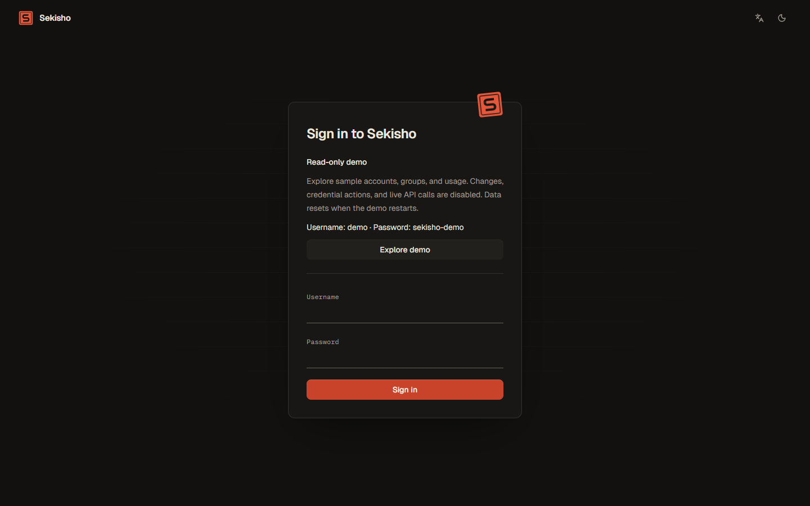
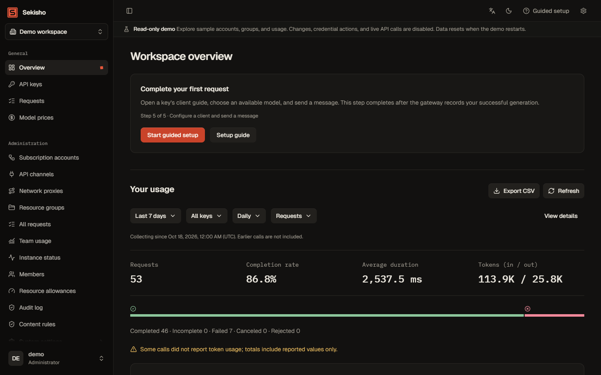
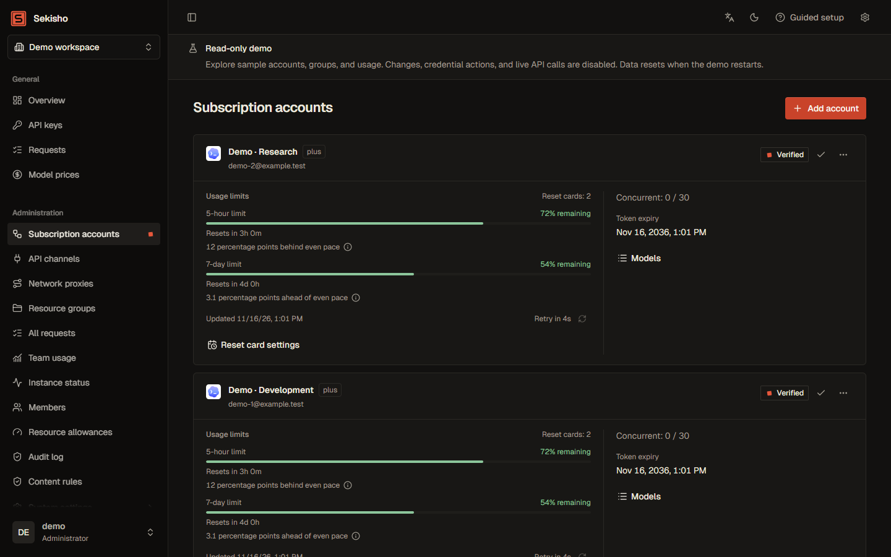
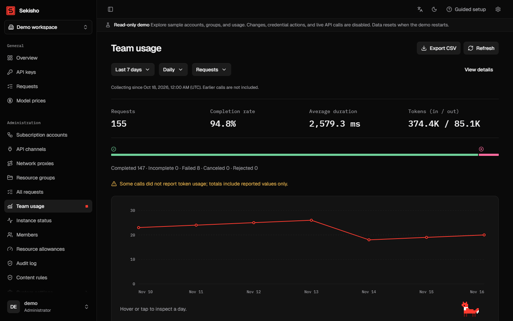

<h1 align="center">
  <picture>
    <source media="(prefers-color-scheme: dark)" srcset="brand/logos/lockup-white.svg">
    
  </picture>
</h1>

<p align="center">
  A lightweight, multi-workspace subscription gateway. Codex first.
</p>

<p align="center">
  <a href="LICENSE"></a>
  <a href="go.mod"></a>
  <a href="web/package.json"></a>
  <a href="internal/storage/storage.go"></a>
  <a href="PRODUCT.md"></a>
</p>

Sekisho brings AI subscriptions into one gateway with isolated workspaces for different teams. It runs as a single Go service with SQLite and a built-in web dashboard.

## Features

- **API channels:** Connect official OpenAI or third-party Chat Completions-compatible services with an API key and base URL, including encrypted keys, model discovery, connection checks, key rotation, existing pools, and usage accounting.
- **Subscription accounts:** Connect Codex, Claude, Antigravity and Grok Build through browser OAuth or credential JSON import, with encrypted credentials, connection checks, model discovery and quota snapshots. Grok uses device-code authorization; quota snapshots cover Codex, Claude usage windows, Antigravity per-model allowance and Grok subscription periods.
- **Client APIs:** OpenAI Responses, Chat Completions and Responses compaction, plus Claude Messages and Gemini generation formats. Requests use HTTP/SSE, with WebSocket support for Responses. Client formats are independent of the selected subscription provider.
- **Workspaces and members:** Isolated accounts, pools, keys, usage and audit records; workspace roles, invitation registration and direct member access grants.
- **Account pools:** Model allowlists, model-aware account selection, conversation affinity, concurrency controls, cooldown recovery, Codex/Claude quota-aware routing and model-specific Antigravity quota admission.
- **Network proxies:** Fixed outbound proxy per account, bulk proxy import and manual exit checks.
- **Personal API keys:** Pool or allowance binding, expiry, pause and revocation controls, owner-only key copying and CC Switch import.
- **Usage controls:** Per-member request rate and concurrency limits, plus optional token or internal USD allowances, including percentage shares across multiple time-window budgets.
- **Content rules:** Optional workspace terms and regular expressions, with observe/block modes, encrypted matching content and checks before model dispatch across HTTP and WebSocket.
- **Operations:** Personal and workspace usage charts, activity heatmaps, request diagnostics, management audit logs, backup creation, verification and restore, and client version settings.
- **Dashboard:** Embedded web interface in 9 languages (English, Japanese, Korean, Spanish, French, German, Portuguese, Russian and Arabic), dark by default with a light theme.

## Screenshots

Captured from the local read-only demo with sample data. Click a preview to open the full image.

| Sign in | Workspace overview |
| --- | --- |
| [](docs/assets/screenshots/sign-in.png) | [](docs/assets/screenshots/overview.png) |
| **Subscription accounts** | **Team usage** |
| [](docs/assets/screenshots/accounts.png) | [](docs/assets/screenshots/usage.png) |

## Getting started

The quickest way to try Sekisho is the published Docker image. It runs on Windows, macOS (Intel and Apple Silicon) and Linux; all you need is [Docker Desktop](https://www.docker.com/products/docker-desktop/), or Docker Engine with Compose on Linux.

### Quick start with Docker

Download [`docker.compose.yaml`](https://github.com/wolfsenberg/sekisho/releases/latest/download/docker.compose.yaml) from the latest release, then start it from the same folder:

```sh
docker compose -f docker.compose.yaml up -d
```

Open http://127.0.0.1:8080, create the administrator, name your first workspace, then follow the guided setup to connect a subscription, add it to an account pool and create a personal key. Data is kept in the `sekisho-data` Docker volume, so it survives restarts and upgrades.

To explore with sample data instead, start a read-only demo:

```sh
SEKISHO_DEMO=true docker compose -f docker.compose.yaml up -d
```

Then choose **Explore demo** on the login page, or sign in as `demo` / `sekisho-demo`. Changes, credential actions and live API calls are disabled, and the data resets when the demo restarts. In PowerShell, set the variable first with `$env:SEKISHO_DEMO="true"`.

Stop Sekisho with `docker compose -f docker.compose.yaml down`. Add `-v` to also delete its data.

### Guided installer (Linux)

On a Linux server, the installer sets up Docker Compose or the native binary, with optional Caddy or Nginx in front:

```sh
curl -fsSL https://raw.githubusercontent.com/wolfsenberg/sekisho/main/scripts/install.sh | bash
```

Binary mode needs a working systemd user manager. Add `--enable-updates` to let the platform owner install new releases from **System settings → Software updates**; this sets up a separate systemd user worker that performs the update outside the web process. Run `bash install.sh --help` for every option.

### Run from source

Requirements:

- Go 1.26 or newer
- Node.js 24 (see `.node-version`) and pnpm 9.12.2 (`corepack enable` picks it up from `web/package.json`)
- GNU Make
- On Windows: run the commands from Git Bash, with Make installed (for example `choco install make`)

```sh
git clone https://github.com/wolfsenberg/sekisho.git
cd sekisho
make setup
make dev
```

Open http://127.0.0.1:5173. `make dev` runs the Go backend on `127.0.0.1:8080` under Air, which rebuilds it when Go code changes, and the Vite dev server with hot reload for the dashboard. The first start compiles everything and can take a couple of minutes. Use `SEKISHO_DEMO=true make dev` for the demo, or `SEKISHO_ADDR=127.0.0.1:9090 make dev` to move the backend to another port.

To build a production binary, run `make build` and start `./bin/sekisho`. To build the Docker image from your checkout, run `docker compose -f docker.compose.yaml -f docker.compose.build.yaml up --build -d`. Settings come from environment variables; [.env.example](.env.example) lists the common ones, and [docker.compose.yaml](docker.compose.yaml) shows every option with its default.

### Software updates

Pull a newer image with `docker compose -f docker.compose.yaml pull` followed by `up -d`. Installations made with the guided installer update with `bash install.sh --update --dir ./sekisho`. Export and verify a backup from **System settings** before updating.

## Development

| Command | What it does |
| --- | --- |
| `make dev` | Backend with live reload plus the Vite dev server |
| `make lint` | `go vet`, gofmt, TypeScript, ESLint and Prettier checks |
| `make test` | Script tests, Go tests with the race detector, and frontend tests |
| `make build` | Production dashboard and binary in `bin/` |
| `make check` | Generated-code drift check, lint, test and build (what CI runs) |

The Go race detector needs a C compiler. On Windows without one, run `go test ./...` and `pnpm --dir web test` in place of `make test`.

Project layout:

- `cmd/sekisho` — the server and CLI entry point
- `internal/` — gateway, accounts, storage (SQLite + sqlc), auth and the HTTP server
- `web/` — React 19 dashboard (Vite, TanStack Router and Query, Tailwind)
- `scripts/` — dev runner, installer, release and packaging scripts
- `brand/` and `tools/brand/` — logo, favicons and the generator that produces them

## Documentation

- [PRODUCT.md](PRODUCT.md) — scope, users and current status
- [DESIGN.md](DESIGN.md) — interface and visual system
- [CONTRIBUTING.md](CONTRIBUTING.md) — workflow, change boundaries and releases
- [SECURITY.md](SECURITY.md) — security model and reporting
- [CHANGELOG.md](CHANGELOG.md) — release history
- [brand/README.md](brand/README.md) — brand materials

## License

[AGPL-3.0-only](LICENSE). See [third-party notices](THIRD_PARTY_NOTICES.md) for dependencies and adapted components.
